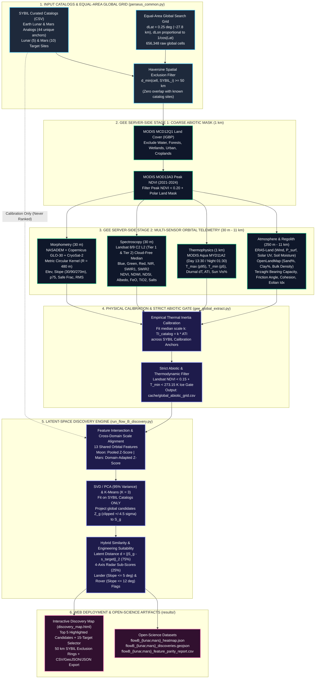

# IRIS — Planetary Analog Global Discovery Engine (Flow B)

**NASA Space Apps Challenge 2026 — Team Perseus**  
**Module:** `IRIS_Flow_B` (Global Orbital Telemetry & Planetary Analog Discovery Pipeline)

> **AI-Assistance Disclosure (NASA Space Apps Submission Guidelines):**  
> This software module and its technical documentation were developed with AI code-generation assistance and subsequently reviewed, calibrated, and scientifically validated by Team Perseus.

---

## 1. Mission Overview & Integration with SYBIL (Flow A)

Within the **Perseus** architecture, terrestrial analog identification is structured into two complementary engines:

* **SYBIL (Flow A — Curated Catalog & High-Resolution Subsystem Analysis):** Evaluates well-documented terrestrial analog sites from planetary geology literature using meter- and sub-meter-scale geotechnical and environmental parameters in MATLAB.
* **IRIS (Flow B — Global Orbital Discovery Engine):** Scales SYBIL's mathematical core to the entire Earth landmass via **Google Earth Engine (GEE)**. IRIS enforces a strict $50\text{ km}$ **Haversine exclusion buffer** around all known SYBIL catalog sites, extracts multi-sensor orbital telemetry ($30\text{ m}$ to $11\text{ km}$) across the **2021–2024** climatological window, and projects global abiotic terrains into SYBIL's calibrated latent space to uncover previously uncatalogued lunar and Martian analogs.

---

## 2. System Architecture & End-to-End Pipeline



---

## 3. Directory Structure

```text
IRIS_Flow_B/
├── perseus_common.py             # Haversine great-circle distance helpers & SYBIL catalog loader
├── gee_global_extract.py         # 2-stage Google Earth Engine multi-sensor extractor & physical derivations
├── run_flow_B_discovery.py       # PCA/SVD projection, K-Means clustering, Radar scoring & GeoJSON/JSON export
├── generate_local_viewer.py      # Standalone Leaflet satellite viewer with Top-5 highlights & CSV/GeoJSON/JSON export
├── requirements.txt              # Python dependencies (earthengine-api, numpy, pandas, scikit-learn)
├── README.md                     # Technical documentation (this file)
├── cache/
│   ├── global_abiotic_grid.csv   # Extracted global abiotic telemetry dataset (28 derived parameters)
│   └── extraction_metadata.json  # Run provenance, sensor parameters, and thermal inertia calibration factor
└── legacy/
    └── extract_global_grid_stac_legacy.py # Archived initial STAC prototype superseded by GEE pipeline
```

---

## 4. NASA & Partner Orbital Datasets Used

All remote sensing reductions run server-side on **Google Earth Engine** over the multi-year climatological window **2021–2024**:

| Physical Domain | Dataset / Mission | GEE Asset ID | Native Resolution | Derived Variables |
| :--- | :--- | :--- | :--- | :--- |
| **Topography & Morphometry** | **NASA NASADEM** (SRTM), **ESA Copernicus GLO-30**, **CryoSat-2 Antarctica** | `NASA/NASADEM_HGT/001`, `COPERNICUS/DEM/GLO30_2024_1`, `CPOM/CryoSat2/ANTARCTICA_DEM` | $30\text{ m}$ (sampled in $R = 480\text{ m}$ metric circle) | `Altitude_m`, `Mean_Slope_deg`, `Traverse_Slope_deg` ($p_{75}$), `Slope_30m/90m/270m_deg`, `Safe_Landing_Frac` ($\le 5^\circ$), `Ultra_Flat_Frac` ($\le 2^\circ$), `RMS_Roughness_m` |
| **Optical & SWIR Spectroscopy** | **NASA/USGS Landsat 8 & 9** Collection 2 Level-2 (`T1_L2` + `T2_L2`) | `LANDSAT/LC08/C02/T1_L2`, `LANDSAT/LC09/C02/T1_L2` (+ `T2_L2`) | $30\text{ m}$ (cloud-masked median via `QA_PIXEL`) | `NDVI`, `NDWI`, `NDSI`, `Albedo`, `Ferric_Oxide_Idx`, `Mafic_Basalt_Idx`, `FeO_wt_pct`, `TiO2_wt_pct`, `Salts_Evaporites_wt_pct`, `Water_Ice_wt_pct` |
| **Land Cover & Vegetation Mask** | **NASA MODIS Terra/Aqua** | `MODIS/061/MCD12Q1`, `MODIS/061/MOD13A3` | $500\text{ m}\text{--}1\text{ km}$ | Stage 1 IGBP land-cover exclusion & peak seasonal $\text{NDVI} < 0.20$ pre-filter |
| **Thermophysics** | **NASA MODIS Aqua** Land Surface Temperature | `MODIS/061/MYD11A2` | $1\text{ km}$ (8-day composite, 13:30 / 01:30 LT) | `T_max_K` ($p_{95}$), `T_min_K` ($p_{5}$), `T_mean_K`, `Diurnal_Delta_T_K`, `ATI`, `Thermal_Inertia`, `Sun_Visibility_pct` |
| **Atmosphere & Soil Mechanics** | **ECMWF ERA5-Land** & **OpenLandMap** | `ECMWF/ERA5_LAND/MONTHLY_AGGR`, `OpenLandMap/SOL/*` | $250\text{ m}\text{--}11\text{ km}$ | `Surface_Pressure_mbar`, `Wind_Mean_mps`, `Wind_Peak_Monthly_mps`, `UV_Flux_Index`, `Friction_Angle_deg`, `Soil_Cohesion_kPa`, `Bearing_Capacity_kPa`, `Eolian_Deflation_Idx` |

---

## 5. Mathematical Formulation & Parity with SYBIL

### 5.1 Geographic Exclusion Guarantee

Every candidate grid cell $g$ must satisfy $d_{\text{Haversine}}(g, a_i) \ge 50.0\text{ km}$ for all $a_i \in \text{SYBIL}$, ensuring zero spatial overlap with previously catalogued analog sites.

### 5.2 Dual-Mode Standardization & Scale Alignment

* **Lunar Analogs:** Pooled Z-Score standardization across Earth calibration analogs and the 5 Lunar target sites ($\mathbf{X}_e \cup \mathbf{X}_t$).
* **Mars Analogs:** Domain-adapted Z-Score standardization where Earth cells are normalized against Earth analog statistics ($\mu_e, \sigma_e$) and Mars targets against Mars statistics ($\mu_t, \sigma_t$).
* **Outlier Clipping & Geotechnical Scaling:** Outlier Z-scores are clipped to $[-4.5\sigma, +4.5\sigma]$, and cross-domain geotechnical variables (such as Terzaghi `Bearing_Capacity_kPa`) are aligned using median anchor ratios on SYBIL calibration sites.

### 5.3 SVD / PCA Latent Projection & K-Means Archetypes

Singular Value Decomposition is fitted **exclusively** on the SYBIL calibration matrix, retaining principal components explaining $\ge 95\%$ of cumulative variance (6 PCs for the Moon, 7 PCs for Mars). Global candidates are projected via $\mathbf{S}_g = \mathbf{Z}_g \mathbf{V}$ and assigned to $K = 3$ geological archetypes via K-Means.

### 5.4 Hybrid Similarity Score

For any reference planetary target $\mathbf{s}_t$, Euclidean latent distance $d = \| \mathbf{S}_g - \mathbf{s}_t \|_2$ is converted into a normalized score calibrated on SYBIL's median distance $d_{\text{median,SYBIL}}$ and blended ($75\% / 25\%$) with the 4-axis **Radar Sub-Scores** (`Morphometry`, `Thermophysics`, `Geochemistry`, `Environment`):

$$\text{Score}_{\text{IRIS}} = 0.75 \cdot \left[100 \exp\left(-\ln(2)\frac{d}{d_{\text{median,SYBIL}}}\right)\right] + 0.25 \cdot \frac{1}{4}\sum_{c=1}^{4} 100 \exp\left(-\frac{\overline{| \mathbf{Z}_{g,c} - \mathbf{z}_{t,c} |}}{\tau}\right)$$

The diagnostic ratio $d / d_{\text{best,SYBIL}} < 1.0$ directly identifies newly discovered terrestrial terrains closer to the planetary target than the best existing analog in the SYBIL catalog.

---

## 6. How to Run

```bash
# 1. Activate Python environment
source .venv/bin/activate

# 2. Extract global abiotic grid from Google Earth Engine (requires registered GCP project)
python3 IRIS_Flow_B/gee_global_extract.py --project YOUR_GCP_PROJECT_ID --mode full --batch-size 150 --workers 6

# 3. Optional: Append high-resolution polar analog provinces (Antarctica + High Arctic)
python3 IRIS_Flow_B/gee_global_extract.py --project YOUR_GCP_PROJECT_ID --append-polar --polar-step-deg 0.25

# 4. Run planetary analog scoring across all 5 Lunar & 10 Martian targets
python3 IRIS_Flow_B/run_flow_B_discovery.py --all-targets

# 5. Generate standalone interactive discovery map (results/perseus_local_viewer.html)
python3 IRIS_Flow_B/generate_local_viewer.py
```

---

## 7. Known Scientific Scope & Limitations

* **Spatial Sampling Step:** At `--mode full` ($0.25^\circ \approx 27.8\text{ km}$ grid spacing), regional geologic provinces (hyperarid basins, basaltic plateaus, evaporitic playas, high-altitude deserts) are captured systematically, while isolated sub-kilometer volcanic vents or small impact craters between grid nodes may not be sampled.
* **Sub-Meter Hazard Resolution:** Meter- and sub-meter-scale hazards (`Boulder_Height_m`, `Slope_1m`, `Pit_Depth_m`) used in SYBIL require local stereo/LiDAR surveys and are explicitly excluded from orbital global scoring rather than synthetically imputed.
* **Spectral Mineralogy Proxies:** $\text{FeO}$, $\text{TiO}_2$, and evaporite weight percentages are multispectral orbital proxies derived from Landsat broadband ratios and should be validated via hyperspectral or *in situ* sampling prior to field campaign deployment.
