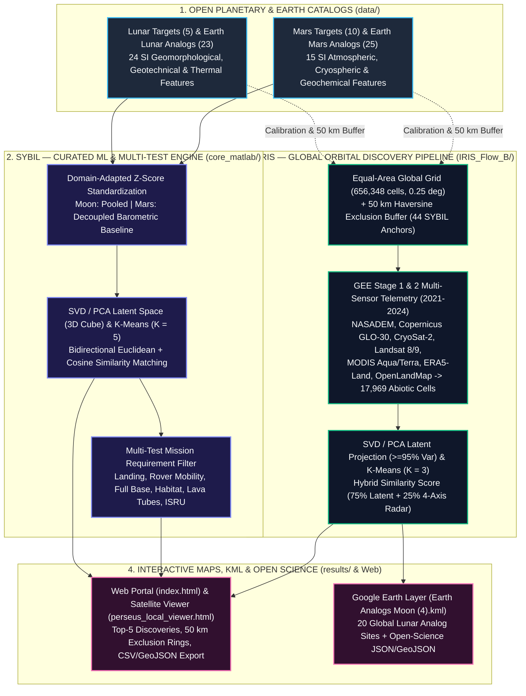

# Perseus: Bidirectional & Global Planetary Analogue Discovery System (Moon & Mars)

**NASA Space Apps Challenge 2026 — Team Perseus**  
**Challenge:** *Identify Earth Locations that Analog the Permanent Moon Base Locations and Mars*

🔗 **Live Web Platform (`index.html`):** `[https://nicolo-sederino.github.io/Perseus_NASA_Space_Apps_challenge_2026/]`  
🗺️ **Interactive Global Discovery Map (`perseus_local_viewer.html`):** `[file:///C:/Users/Lucrezia/Downloads/perseus_local_viewer%20(3).html]`  
🎥 **Project Demo / Pitch Deck (`docs/`):** `[INSERT_PUBLIC_DEMO_LINK_HERE]`

> **AI-Assistance Disclosure (NASA Space Apps Submission Guidelines):**  
> Components of the `IRIS_Flow_B` orbital extraction pipeline, web interface, and technical documentation were developed with AI code-generation assistance and subsequently calibrated, audited, and scientifically validated by Team Perseus.

---

## 1. Executive Summary & How We Solved the Challenge

Selecting future landing sites and permanent surface bases on the Moon and Mars requires matching complex mission constraints—topography, geology, thermophysics, radiation, regolith mechanics, and *in-situ* resource utilization (ISRU)—with terrestrial testbeds. However, **no single location on Earth is a universal planetary analogue**:
* An active basaltic volcano (e.g., *Mount Etna*) replicates loose lapilli traction and lava-tube geometry, yet cannot reproduce cryogenic temperatures or ultra-high vacuum.
* A hyperarid cold desert (e.g., *McMurdo Dry Valleys* or *Atacama*) replicates extreme aridity, UV stress, and permafrost sublimation, yet lacks lunar anorthositic crust or volcanic skylights.

**Perseus** solves this problem by transforming static, poorly characterized site lists into a **Dual-Engine, Quantitative Planetary Analogue Discovery System**:
1. **SYBIL (`core_matlab/Sybil_Machine_Learning.m` — Flow A):** A high-resolution, unsupervised machine learning engine calibrated on **44 curated terrestrial analog sites** and **15 reference planetary targets** (5 Lunar, 10 Martian) across multi-domain SI parameters. It supports bidirectional matching (**Planet $\leftrightarrow$ Earth**) and a **Multi-Test Mission Planner** that filters terrestrial testbeds by concrete operational requirements (*Landing/Touchdown, Rover Mobility, Full Lunar Base, 2–4 Crew Habitat, Lava-Tube EVA, and Power/ISRU*).
2. **IRIS (`IRIS_Flow_B/` — Flow B):** A planetary-scale remote sensing discovery pipeline powered by **Google Earth Engine (GEE)**. Enforcing a strict **$50\text{ km}$ Haversine exclusion buffer** around every known SYBIL site, IRIS screens **656,348 equal-area global grid cells** using 2021–2024 orbital telemetry ($30\text{ m}$ to $11\text{ km}$) and projects **17,969 newly characterized abiotic/cryogenic terrains** into SYBIL's calibrated latent space—uncovering previously uncatalogued terrestrial analogs that match or outperform existing reference sites.
3. **Interactive Web, GIS & KML Visualization (`index.html`, `perseus_local_viewer.html`, `Earth Analogs Moon (4).kml`):** Browser-ready dashboards, interactive Leaflet discovery maps with 50 km exclusion rings and CSV/GeoJSON/JSON export, and Google Earth KML layers for immediate mission-team exploration.

---

## 2. End-to-End System Architecture



---

## 3. How We Leveraged Open NASA & Space Agency Data

To ensure physical fidelity across planetary bodies, Perseus integrates open orbital telemetry, digital elevation models, climate reanalyses, and peer-reviewed mission retrievals from NASA and international space agency partners:

| Domain | Missions, Sensors & Open Datasets | Extracted & Derived SI Parameters |
| :--- | :--- | :--- |
| **Moon Targets (`Lunar_Targets_Catalog.csv`)** | **NASA LRO** (*Diviner*, *LOLA*, *LROC NAC*, *Mini-RF*), **LCROSS**, **ISRO Chandrayaan-1** (*M³*), **JAXA Kaguya** (*TC/MI*) | Multiscale slopes ($1\text{ m} / 5\text{ m} / 25\text{ m}$), Hurst roughness, boulder height & area fraction, safe landing area ($\text{m}^2$), regolith bulk density ($0\text{--}15\text{ cm}$ & $0\text{--}60\text{ cm}$), cohesion ($\text{kPa}$), friction angle ($^\circ$), Terzaghi bearing capacity ($\text{kPa}$), $\text{FeO}$ & $\text{TiO}_2\text{ wt}\%$, $T_{\min}/T_{\max}\text{ (K)}$, thermal inertia, sun visibility ($\%$), Direct-to-Earth comms ($\%$), water-ice $\text{wt}\%$, skylight/pit geometry |
| **Mars Targets (`Mars_Targets_Catalog.csv`)** | **NASA MRO** (*HiRISE*, *SHARAD*, *CRISM*), **MSL Curiosity** (*REMS/RAD*), **Phoenix**, **Mars Odyssey**, **NASA Mars Fact Sheet** | Elevation ($\text{m}$), mean & max slopes ($^\circ$), surface atmospheric pressure ($\text{mbar}$), diurnal temperature extremes ($T_{\min}, T_{\max}$), mean & gust wind speeds ($\text{m/s}$), buried/glacial water-ice $\text{wt}\%$, soil cohesion & friction angle, sulfate/perchlorate/evaporite $\text{wt}\%$, UV flux index, mafic basalt index, eolian deflation index |
| **Earth Curated Analogs (`data/Earth_*_Catalog.csv` & `.kml`)** | **NASA** (*Landsat TIRS*, *ECOSTRESS*), **ESA** (*PANGAEA*, *LUNA*, *Etna*, *Lanzarote*, *Nusfjord*), **CSA** (*Haughton*, *Mistastin*), **JAXA** (*Miyake-jima*), **CONAE** (*Andean Salars*) | 44 calibrated terrestrial benchmarks spanning basaltic maria analogs (*Black Point*, *Etna*, *Harrat Khaybar*, *Payenia*), pure anorthosite massifs (*Nusfjord*, *Miyake-jima*), lava tubes (*Marius/Tranquillitatis analogs: Terceira, Jeju, Jingpo, Craters of the Moon*), impact craters (*Haughton*, *Nördlinger Ries*, *Lonar*), and hyperarid/periglacial Mars sites (*McMurdo*, *Salar de Arizaro*, *Qaidam Basin*, *Svalbard*, *Bardenas Reales*) |
| **Earth Global Discovery (`IRIS_Flow_B/` via GEE, 2021–2024)** | **NASA NASADEM**, **ESA Copernicus GLO-30**, **CryoSat-2 Antarctica**, **NASA/USGS Landsat 8 & 9** (`C02/T1_L2` + `T2_L2`), **NASA MODIS** (`MCD12Q1`, `MOD13A3`, `MYD11A2`), **ECMWF ERA5-Land**, **OpenLandMap** | Server-side reductions over metric circular kernels & grid cells: slopes, safe landing fraction, RMS roughness, cloud-free spectral indices, broadband mineralogical proxies, day/night LST extremes, empirically calibrated thermal inertia, surface pressure, wind regime, UV flux, and geotechnical bearing capacity |

---

## 4. Methodology & Scientific Validation

### 4.1 Domain-Adapted Standardization & Latent Space Projection
* **Lunar Pipeline:** Applies pooled Z-score normalization across Earth analogs and the 5 Lunar targets (*Shackleton Rim, Mare Tranquillitatis Pit, Marius Hills Skylight, Oceanus Procellarum, Descartes Highlands*).
* **Martian Pipeline:** Decouples Mars' extreme barometric baseline from Earth's via separate domain Z-score standardization so atmospheric pressure differentials do not mask surface geology, slope morphometry, and geochemical indices.
* **SVD / PCA & Clustering:** Singular Value Decomposition projects sites into a shared principal component space (retaining $\ge 95\%$ variance: **6 PCs for the Moon**, **7 PCs for Mars** in IRIS; **3D interactive PCA cubes** in SYBIL), while K-Means groups terrestrial environments into operational geological archetypes ($K=5$ in SYBIL, $K=3$ in IRIS).

### 4.2 Dual-Metric & Hybrid Similarity Scoring
* **SYBIL (Flow A):** Ranks bidirectional matches (**Planet $\leftrightarrow$ Earth**) via Euclidean distance in full PCA space and Cosine Similarity, paired with 4-axis geophysical Radar Charts and explicit **Engineering Fidelity Warnings**.
* **IRIS (Flow B):** Computes a calibrated **Hybrid Similarity Score** combining Euclidean latent distance ($75\%$) with 4-axis Radar sub-scores (`Morphometry`, `Thermophysics`, `Geochemistry`, `Environment`, $25\%$). Candidates achieving $d / d_{\text{best,SYBIL}} < 1.0$ represent newly discovered global locations closer to the planetary target in orbital parameter space than the closest benchmark in the curated catalog.

### 4.3 Satellite-to-Catalog Parity & Key Global Discoveries (`results/`)
Cross-checking GEE orbital retrievals against ground-truth catalog anchors (`results/flowB_*_feature_parity_report.csv`) confirms strong physical agreement across macro-environmental variables—notably on Mars for **Altitude** ($r = 0.992$), **Minimum Temperature** ($r = 0.976$), **Surface Pressure** ($r = 0.903$), **Mean Slope** ($r = 0.898$), **Maximum Temperature** ($r = 0.846$), and **Mafic Basalt Index** ($r = 0.786$), and on the Moon for **$T_{\min}$** ($r = 0.831$), **$T_{\max}$** ($r = 0.757$), and **Sun Visibility** ($r = 0.669$).

Examples of newly discovered global analogs outside the 50 km SYBIL exclusion buffer include:
* **Lunar South Pole / Shackleton Rim (`PERSEUS_+036.12_+0077.08` — Karakoram / Western Kunlun High-Altitude Barren Terrain, $5,491\text{ m}$):** Achieves a hybrid similarity score of **63.82** ($d / d_{\text{best,SYBIL}} = 0.883$, cosine similarity $0.775$), combining cryogenic minimum temperatures ($237.8\text{ K}$), high solar illumination ($81.4\%$), low $\text{FeO}/\text{TiO}_2$ highlands-like composition, and rover-traversable slopes ($8.2^\circ$).
* **Descartes Highlands Anorthositic Crust (`PERSEUS_+045.12_+0060.41`):** Achieves $d / d_{\text{best,SYBIL}} = 0.938$ (score **59.35**), offering a new feldspar-rich arid testbed $1,000+\text{ km}$ from existing catalog sites.
* **Martian Glacial Belts / Deuteronilus Mensae (`PERSEUS_+078.75_-0101.57` — Canadian High Arctic Polar Desert):** Achieves a hybrid score of **78.13** with strong cryospheric and thermal parity for shallow subsurface ice-extraction testing.

---

## 5. Repository Structure

```text
Perseus_NASA_Space_Apps_challenge_2026/
├── index.html                        # Main interactive web application (Lunar, IRIS, Mars & ML tabs)
├── perseus_local_viewer.html         # Standalone Leaflet satellite viewer for global discoveries
├── Earth Analogs Moon (4).kml        # Google Earth KML layer with 20 georeferenced lunar analog sites
├── LICENSE                           # MIT License (Copyright 2026 Nicolò Sederino)
├── .nojekyll / .gitignore            # Static hosting & repository configuration
├── data/                             # Curated SI planetary & terrestrial CSV catalogs
│   ├── Lunar_Targets_Catalog.csv     # 5 reference lunar landing/base targets (24 physical features)
│   ├── Earth_Lunar_Analogs_Catalog.csv # 23 curated terrestrial lunar analogs
│   ├── Mars_Targets_Catalog.csv      # 10 reference Martian targets (15 physical features)
│   └── Earth_Mars_Analogs_Catalog.csv  # 25 curated terrestrial Martian analogs
├── core_matlab/                      # Flow A: SYBIL analytical engine
│   └── Sybil_Machine_Learning.m      # PCA/SVD 3D cubes, K-Means, Radar Charts & Multi-Test Site Finder
├── IRIS_Flow_B/                      # Flow B: Global orbital discovery pipeline (Python + GEE)
│   ├── perseus_common.py             # Haversine great-circle helpers & SYBIL catalog loader
│   ├── gee_global_extract.py         # 2-stage GEE multi-sensor extractor & physical derivations
│   ├── run_flow_B_discovery.py       # SVD/PCA projection, K-Means, Radar scoring & GeoJSON export
│   ├── generate_local_viewer.py      # Standalone HTML/Leaflet map builder
│   ├── requirements.txt              # Python dependencies (earthengine-api, numpy, pandas, scikit-learn)
│   ├── README.md                     # Detailed technical documentation for Flow B
│   ├── cache/                        # Extracted global abiotic grid (17,969 cells) & run metadata
│   └── legacy/                       # Archived initial STAC prototype
├── results/                          # Open-science outputs (GeoJSON, top-25 JSONs, heatmaps, parity CSVs)
└── docs/                             # Presentation & mission-design documentation
```

---

## 6. Quickstart & Reproducibility

### A. Explore the Web App & GIS Layers (Zero Setup)
* Open **`index.html`** in any modern browser to explore the mission overview, engineering thresholds, and interactive planetary dashboards.
* Open **`perseus_local_viewer.html`** (or `results/perseus_local_viewer.html`) to inspect the Top-5 newly discovered analogs for all 15 Lunar and Martian targets, toggle $50\text{ km}$ SYBIL exclusion rings, and export filtered subsets as CSV, GeoJSON, or JSON.
* Load **`Earth Analogs Moon (4).kml`** directly into **Google Earth Web / Pro** to inspect the 20 global lunar testbeds in 3D terrain view.

### B. Run SYBIL (Flow A — MATLAB)
1. Open MATLAB and set the working directory to `core_matlab/` (ensuring the CSV files from `data/` are on the MATLAB path or copied locally).
2. Run `Sybil_Machine_Learning.m` to generate the interactive 3D PCA cubes, comparative Radar Charts with SI unit tooltips, global analog maps, and the interactive **Multi-Test Earth Site Selection** CLI module.

### C. Run IRIS Global Discovery (Flow B — Python & Google Earth Engine)
```bash
# 1. Install dependencies
pip install -r IRIS_Flow_B/requirements.txt

# 2. Extract global abiotic grid via Google Earth Engine (requires registered GCP project)
python3 IRIS_Flow_B/gee_global_extract.py --project YOUR_GCP_PROJECT_ID --mode full --batch-size 150 --workers 6

# 3. Optional: Append high-latitude polar provinces (Antarctica + High Arctic)
python3 IRIS_Flow_B/gee_global_extract.py --project YOUR_GCP_PROJECT_ID --append-polar --polar-step-deg 0.25

# 4. Run latent-space discovery scoring across all 5 Lunar & 10 Martian targets
python3 IRIS_Flow_B/run_flow_B_discovery.py --all-targets

# 5. Rebuild the standalone interactive discovery viewer
python3 IRIS_Flow_B/generate_local_viewer.py
```
