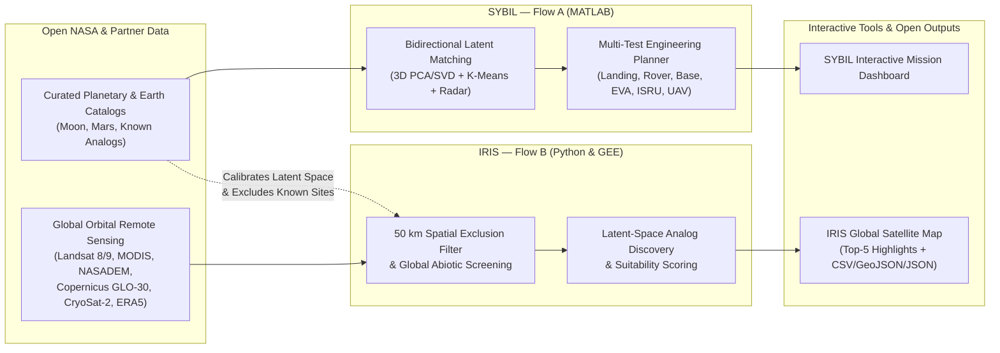

[perseus_repository_readme.md](https://github.com/user-attachments/files/34873706/perseus_repository_readme.md)
# PERSEUS — Planetary Analog Discovery & Mission Test Planning System
**NASA Space Apps Challenge 2026 | Team Perseus**

> **Challenge:** *Identify Earth Locations that Analog the Permanent Moon Base Locations and Mars*  
> **Live Interactive Discovery Map:** [Explore the IRIS Global Analog Map](https://nicolo-sederino.github.io/Perseus_NASA_Space_Apps_challenge_2026/) *(replace/verify your GitHub Pages URL)*

> **AI-Assistance / Super Intelligence (SI) Disclosure:**  
> In accordance with the NASA Space Apps 2026 Project Submission Guidelines, generative AI tools were utilized as an engineering aid to accelerate software development, data-pipeline structuring, and technical documentation. All scientific methodology, physical models, planetary catalogs, and validation outputs were conceived, calibrated, and verified by Team Perseus.

---

## 1. The Mission & Scientific Vision
Before humans and robotic systems land on the Moon or Mars, hardware, habitats, rovers, and operational procedures must be rigorously tested on Earth. However, no single terrestrial location replicates every extraterrestrial condition simultaneously: a site ideal for testing rover traction on loose basaltic regolith may lack the cryogenic temperatures or extreme UV radiation required to validate habitat thermal control or ISRU (In-Situ Resource Utilization) systems. Furthermore, historical analog campaigns have relied on a limited set of well-known sites—leaving vast, uncharacterized regions of Earth untapped.

**Project Perseus** bridges this gap by combining deep planetary engineering with open orbital remote sensing and unsupervised machine learning. Rather than treating analog selection as a static lookup table, Perseus operates as a **dual-engine decision-support and global discovery ecosystem**:

1. **SYBIL (Flow A — Curated Catalog & High-Resolution Subsystem Analysis):**  
   Named after the ancient oracles, **SYBIL** is an interactive mission-planning system built in MATLAB. Grounded in peer-reviewed lunar and Martian engineering literature, SYBIL evaluates documented terrestrial analog sites across meter- and sub-meter-scale geotechnical, morphometric, and environmental parameters. It allows mission planners to compare any terrestrial site against specific Lunar and Martian targets and run **Multi-Test Mission Queries** (e.g., finding where to test *Landing + Rover Mobility + Habitat Deployment* simultaneously).
2. **IRIS (Flow B — Global Orbital Telemetry & Planetary Analog Discovery Engine):**  
   Named after the messenger connecting distant realms, **IRIS** scales SYBIL's mathematical core to the entire Earth landmass via Google Earth Engine. By enforcing a strict **50 km spatial exclusion buffer** around all known catalogued sites, IRIS scans hundreds of thousands of abiotic terrestrial cells (hyperarid deserts, volcanic plateaus, evaporitic basins, high-altitude mountains, and polar regions) using NASA and space-agency partner satellite data to **discover and rank brand-new, uncatalogued terrestrial analogs** for future lunar bases and Martian missions.

---

## 2. How Perseus Addresses the Judging Criteria
* **Relevance & Open Space Data Integration:** Perseus is built directly on open planetary and Earth-observation datasets from **NASA** (Landsat 8/9 Collection 2, MODIS Terra/Aqua, NASADEM, LRO/Diviner, MRO/HiRISE, Mars Fact Sheets) and **Space Agency Partners** (**ESA** Copernicus GLO-30 DEM, CryoSat-2 Antarctica DEM, Mars Express/PANGAEA literature), turning raw orbital telemetry into actionable exploration intelligence.
* **Scientific Validity & Engineering Realism:** Instead of generic "look-alike" matching, Perseus distinguishes between **regional orbital characterization** (slopes at 30–270 m, thermal inertia, albedo, spectral mineral proxies, wind deflation, soil bearing capacity) and **local sub-meter hazards** (boulder distributions, lava tube skylight geometry, pit stability). Each candidate site is explicitly flagged for **Lander** ($\le 5^\circ$ slope) and **Rover** ($\le 12^\circ$ traverse slope) operational suitability.
* **Creativity & Dual-Engine Synergy:** Combining a high-resolution subsystem test planner (**SYBIL**) with a blind global satellite discovery engine (**IRIS**) calibrated in the same latent PCA/SVD space creates a closed scientific loop: SYBIL defines the physical benchmark, while IRIS expands the global catalog beyond historical bias.
* **Impact & Open-Science Accessibility:** All discovered sites, multi-axis similarity scores, and engineering telemetry are made freely accessible through an interactive web-based satellite viewer with one-click export in **CSV, GeoJSON, and JSON** formats for researchers, engineers, and educators worldwide.

---

## 3. System Architecture & Workflow



### SYBIL: Mission Test Planning & Subsystem Matching
SYBIL ingests four domain-curated catalogs covering key Lunar targets (e.g., Shackleton Rim, Mare Tranquillitatis, Marius Hills, Aristarchus Plateau, Fra Mauro) and Martian targets (e.g., Jezero Crater, Gale Crater, Arcadia Planitia, Deuteronilus Mensae, Olympus/Tharsis provinces) alongside documented terrestrial analogs worldwide.
* **Interactive Latent Space & Radar Signatures:** Projects Earth and planetary sites into a shared Principal Component space, allowing users to inspect 3D topological clustering and multi-axis geophysical radar signatures side by side.
* **Multi-Test Site Finder:** Mission designers can select single or combined operational test campaigns—such as *Touchdown/EDL*, *Rover Mobility*, *Full Surface Base*, *2–4 Crew Habitat*, *Lava Tube / Subsurface EVA*, *High-Altitude UAV Flight*, and *ISRU / Volatile Prospecting*—to identify which terrestrial sites satisfy every physical constraint (or rank the best multi-role compromises).

### IRIS: Global Discovery of New Terrestrial Analogs
To overcome the limitation that existing analog lists focus only on famous, easily accessible locations, IRIS systematically searches the globe for unexploited analog provinces:
1. **Zero-Overlap Guarantee:** Every known site in SYBIL is surrounded by a **50 km Haversine exclusion zone**, ensuring IRIS only proposes genuinely new geographic locations.
2. **Global Abiotic Filtering:** Using cloud-based Earth observation, IRIS filters out vegetated, urban, agricultural, and aquatic regions, retaining barren deserts, volcanic fields, salt playas, high-altitude plateaus, and ice-free polar/cryogenic terrains.
3. **Physics-Informed Orbital Telemetry:** Extracts multi-year (2021–2024) topography, multi-scale slopes, diurnal thermal cycles, empirical thermal inertia, broadband geochemical proxies ($\text{FeO}$, $\text{TiO}_2$, ferric oxides, evaporitic salts, water ice), atmospheric pressure, wind deflation, and Terzaghi soil bearing capacity.
4. **Hybrid Similarity & Interactive Exploration:** Projects global candidates into SYBIL's calibrated latent space, ranking them by a hybrid score combining Euclidean latent proximity and 4-axis geophysical radar similarity (*Morphometry, Thermophysics, Geochemistry, Environment*). Results are published in an interactive satellite map highlighting the **Top 5 newly discovered sites** for every Lunar and Martian target.

---

## 4. Repository Structure

```text
Perseus_NASA_Space_Apps_challenge_2026/
├── README.md                    # Project overview, scientific vision, and architecture (this file)
├── LICENSE                      # Open-source license
├── index.html                   # Web-deployed IRIS interactive discovery map (GitHub Pages)
├── data/                        # Curated planetary target & terrestrial analog catalogs (CSV)
│   ├── Earth_Lunar_Analogs_Catalog.csv
│   ├── Earth_Mars_Analogs_Catalog.csv
│   ├── Lunar_Targets_Catalog.csv
│   └── Mars_Targets_Catalog.csv
├── core_matlab/                 # SYBIL (Flow A): MATLAB ML discovery & multi-test mission planner
│   └── Sybil_Machine_Learning.m
├── IRIS_Flow_B/                 # IRIS (Flow B): Google Earth Engine extraction & global discovery
│   ├── README.md                # Detailed mathematical & sensor pipeline documentation for IRIS
│   ├── perseus_common.py        # Spatial exclusion & catalog utilities
│   ├── gee_global_extract.py    # Multi-sensor orbital telemetry extraction
│   ├── run_flow_B_discovery.py  # Latent projection, clustering, and analog ranking
│   └── generate_local_viewer.py # Interactive Leaflet satellite map generator
├── results/                     # Generated GeoJSON, JSON, parity reports, and local HTML viewer
└── docs/                        # Scientific literature synthesis & hackathon presentation
```

---

## 5. Quick Start

* **Explore the Live Discovery Map:** Open `index.html` (or visit our GitHub Pages deployment) to switch between **Moon** and **Mars**, select any of the 15 planetary reference targets, inspect the **Top 5 newly discovered Earth analogs**, toggle the **50 km SYBIL exclusion rings**, and download filtered datasets in **CSV, GeoJSON, or JSON**.
* **Run SYBIL (Mission Test Planner):** Open `core_matlab/Sybil_Machine_Learning.m` in MATLAB with the `data/` catalogs in your working path to launch the interactive 3D PCA/Radar dashboards and the command-line Multi-Test Site Finder.
* **Run IRIS (Global Discovery Pipeline):** See [`IRIS_Flow_B/README.md`](IRIS_Flow_B/README.md) for instructions on running the Google Earth Engine extraction and global analog scoring scripts.

---

## 6. Scientific References & Data Sources
* **NASA Open Data & Missions:** Landsat 8/9 Collection 2 Level-2 (USGS/NASA), MODIS Terra/Aqua (`MCD12Q1`, `MOD13A3`, `MYD11A2`), NASADEM (`NASADEM_HGT`), Lunar Reconnaissance Orbiter (LOLA & Diviner Lunar Radiometer), Moon-to-Mars Architecture *Lunar Site Selection* White Paper (2024), *Artemis III Science Definition Team Report*, and Mars Exploration Program environmental datasets.
* **Space Agency Partner & Open Earth Resources:** ESA Copernicus DEM (`GLO-30`), ESA CryoSat-2 Antarctica DEM, ESA PANGAEA / LUNA analog documentation, and ECMWF ERA5-Land / OpenLandMap global environmental layers.
* **Team Perseus Technical Reports:** Comprehensive engineering and planetary science syntheses compiled in `docs/` covering Lunar landing/base morphometry, regolith geotechnics, subsurface lava tubes, and Martian hyperarid/cryospheric analogs.
